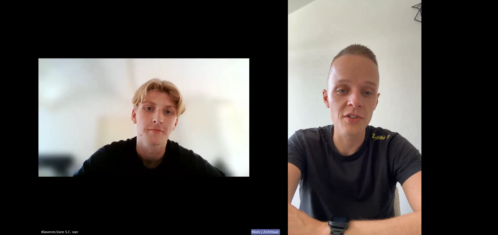
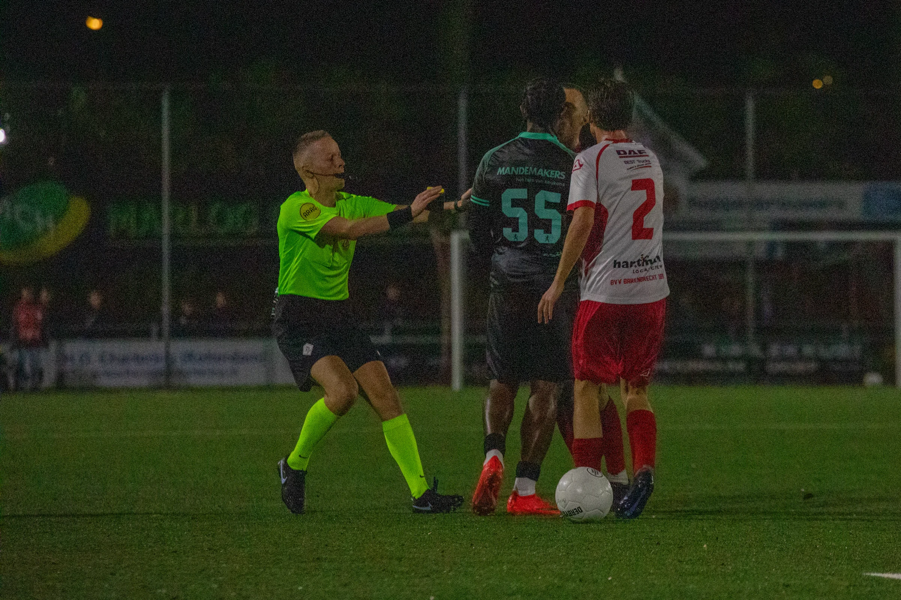

Een scheidsrechter staat tijdens een wedstrijd volop in de aandacht, maar kritiek hoort daar ook bij. Dat merkt Boel zelf ook, want kritiek laat hem niet volledig koud. “Tuurlijk ben ik ook niet van steen, dus ik kan niet ontkennen dat dat af en toe wat met je doet.” zegt hij.  

Een beslissing van de scheidsrechter kan bij iedereen tijdens een wedstrijd veel losmaken. “Iedereen handelt op zo’n moment wel uit een bepaalde emotie, waarin denk ik heel veel mensen niet echt honderd procent zichzelf zijn.”  Daar houdt de Zeeuw dus wel rekening mee. 

Boel heeft in de afgelopen jaren geleerd om beter met kritiek en fouten om te gaan. Een verkeerde beslissing kan wel nog steeds bij hem blijven hangen. “Waar ik voorheen vijf dagen slecht was van een slechte beslissing, is dat misschien nu nog maar twee.” 

**Uitstraling** 

Naarmate het niveau hoger wordt, merkt Boel dat ook zijn uitstraling steeds belangrijker wordt. Een beslissing nemen is volgens hem één ding, maar hij moet die beslissing ook duidelijk overbrengen naar de spelers en het publiek. “Ik kan wel tegen jou zeggen dat ik het vervelend vind dat jij een overtreding maakt. Maar dat moet ik ook wel uitstralen voor het hele stadion.”

Daarbij speelt ook zijn lichaamstaal een belangrijke rol. “Ik kan verbaal iets tegen jou zeggen, maar als ik non-verbaal ook even zo’n gebaar maak, dan is het klaar.” Boel gebruikt dus niet alleen woorden om duidelijk te maken wat hij bedoelt. 

_Boel maakt zijn beslissing duidelijk met zijn uitstraling_

Duidelijkheid is erg belangrijk als scheidsrechter, zodat de spelers weten waar ze aan toe zijn. Als een scheidsrechter niet duidelijk communiceert, kan een speler bijvoorbeeld niet goed inschatten hoe dicht hij bij een volgende kaart zit. Een duidelijke houding en communicatie kunnen daardoor veel onzekerheid op het veld veroorzaken. 

**Volgende stap** 

Boel kijkt ondertussen vooral vooruit. Zijn loopbaan als scheidsrechter begon bij Talenttrack Zuid, een opleidingstraject voor jonge scheidsrechters. Van daaruit stroomde hij door naar Talenttrack Landelijk en uiteindelijk naar het betaald voetbal.  

Ruim een jaar geleden maakte Boel zijn debuut in de Keuken Kampioen Divisie. Inmiddels kijkt hij alweer naar wat daarna komt. “Ik probeer het wel heel erg stap voor stap te bekijken. Ik heb nu mijn debuut gemaakt in de KKD en de volgende stap is mijn debuut in de Eredivisie. Dus dat is op dit moment mijn ambitie.” 

Voor Boel is de Eredivisie dus het volgende doel. Daar wil hij uiteindelijk een vaste plek veroveren en zich verder ontwikkelen als scheidsrechter.
