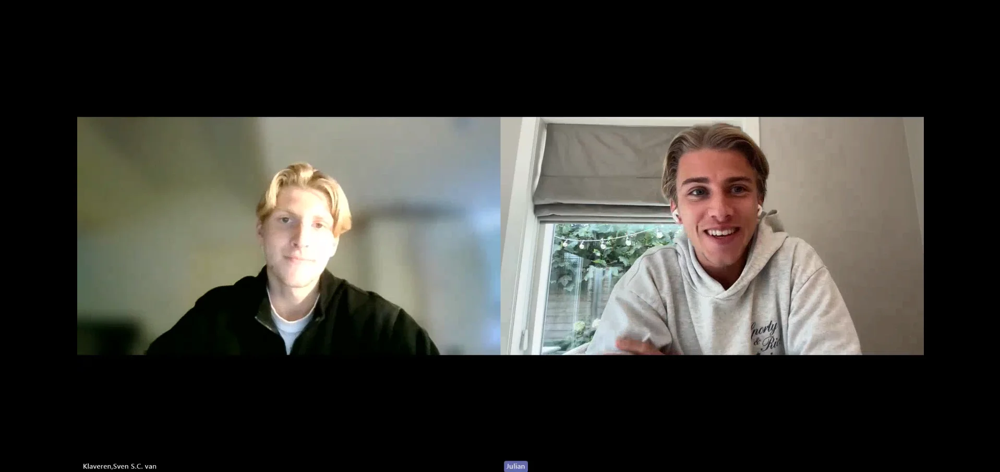

Door het werk van zijn vader bij Shell groeide Jansen op in verschillende landen, waaronder Engeland, Oostenrijk, Singapore en Nederland. Op zijn vijftiende vertrok hij alleen naar Engeland om voetbal en onderwijs te combineren op een kostschool. Daar kreeg hij de kans om zich verder te ontwikkelen bij de jeugdopleiding van Bolton Wanderers. 

Zijn jeugd in het buitenland bracht hem op verschillende plekken. In Wenen zat Jansen op een internationale school en voetbalde hij korte tijd bij Rapid Wien in de jeugd. Later woonde hij ongeveer vier jaar in Singapore, dat was volgens hem de beste tijd van zijn jeugd. 

**Eenzaam op Sicilië** 

Tussen zijn Engelse clubs speelde Jansen een halfjaar op Sicilië bij Sancataldese Calcio. Daar maakte hij bijzondere dingen mee. ‘Niemand sprak Engels, dus ik liep daar rond met mijn Google Translate’, vertelt hij. De club waarvoor hij speelde, was volgens Jansen in handen van de maffia. Spelers kregen hun salaris contant in enveloppen. 

Ook buiten het voetbal was de periode zwaar. Jansen woonde in een klein dorp, sprak de taal nauwelijks en miste het contact met vrienden. ‘In die periode heb ik me wel heel erg eenzaam gevoeld’, zegt hij. Uiteindelijk besloot hij na een halfjaar te vertrekken. Toch kijkt hij positief terug op de ervaring. ‘Je wordt uit je comfortzone getrokken, dus daar leer je ook gewoon heel erg veel van.’ 

**Voetbal combineren met ondernemen** 

Terug in Nederland speelde Jansen bij Rijnvogels en later Ter Leede. Omdat hij bij zijn Nederlandse amateurclubs minder met voetbal bezig was dan in Engeland, ging hij nadenken over zijn toekomst. Hij richtte een eigen supplementenbedrijf op, waarmee hij producten verkoopt aan bedrijven in het Midden-Oosten.  

Halverwege het vorige seizoen maakte hij de overstap naar SVV Scheveningen. Daar kan hij zijn voetbal en onderneming voorlopig goed combineren. Toch weet hij dat er mogelijk een moment komt waarop hij moet kiezen. 

‘Op dit moment wil ik het allebei niet weggeven’, vertelt Jansen. Een stap hogerop in het voetbal lijkt hem nog steeds interessant. Mocht hij uiteindelijk toch moeten kiezen, dan is zijn beslissing duidelijk: ‘Dan kies ik natuurlijk wel gewoon voor mijn bedrijf. Dat kan je natuurlijk ook veel langer doen dan voetbal.’
